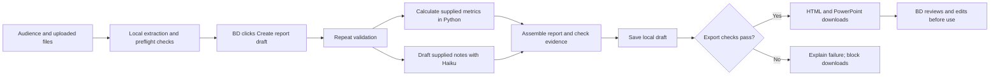

# MEP reporting workflow — technical design

**Submission version · 10 October 2026.** This document describes the current implementation and proposed pilot/production work. NIG and the MEP operating scenario are fictional. Interviews, staffing, costs and time savings are scenario assumptions; automated tests and recorded synthetic model evaluations are identified separately.

## 1. Problem, user and selection

The user is a senior Business Development manager preparing for an engineering, vendor or partner meeting. BD collects notes, transcripts, emails and platform exports, checks progress against previous actions, calculates changes and assembles a brief. Decisions, commitments, meeting attendance and follow-through remain human responsibilities.

The selected cluster is **Analytics & Strategy**: turn existing evidence into useful reports and release capacity for partner development. The primary demonstration is weekly BD–engineering preparation. Vendor and Partner reuse this weekly pipeline with different drafting instructions. All are internal preparation briefs, not automatically cleared external communications. This is reporting assembly, not a knowledge chatbot or ticket-routing system.

ICE is the equal-weight mean of Impact, Confidence and Ease, each scored 1–10. Impact considers repeated effort and decision usefulness; Confidence considers evidence for feasibility and value; Ease considers implementation effort and dependencies. These are prioritisation assumptions, not measured business results.

| Workflow | Impact | Confidence | Ease | ICE | Reason |
| --- | ---: | ---: | ---: | ---: | --- |
| Weekly engineering-report preparation | 8 | 6 | 8 | **7.3** | Frequent, bounded and measurable |
| Monthly partner reporting | 7 | 6 | 5 | 6.0 | Recipient-specific tailoring and confidentiality add work |
| Quarterly leadership reporting | 6 | 5 | 6 | 5.7 | Less frequent; broader commercial context |
| Engineering prioritisation | 9 | 4 | 3 | 5.3 | Capacity trade-offs and commitments need human ownership |

Confidence stays moderate because adoption and savings are unmeasured. Ease eight describes the file-based prototype, not enterprise deployment. The Vendor/Partner selectors do not implement the broader monthly opportunities above.

## 2. Current scope and user experience

| Implemented | Outside the working prototype |
| --- | --- |
| Audience/week selection; mixed-file upload; optional pasted notes | Live SharePoint, OneDrive, Teams, email, CRM or Jira integrations |
| Local parsing/validation; metrics-only, notes-only or combined reports | OCR, audio transcription, handwritten-image recognition, legacy `.doc`, arbitrary spreadsheet interpretation |
| Deterministic KPI changes; automatic Haiku drafting when notes exist | Assisted intake, retrieval/RAG, fine-tuning, autonomous tools or model routing |
| Source-ID and exact-quote checks; local saved-report library | Enterprise identity, partner isolation, managed retention, durable multiuser jobs and operational monitoring |
| Written HTML and editable PPTX downloads from the same report | Native Word/DOCX export, automatic publication, task creation or sending |
| Separate model-comparison screen and saved evaluation records | Measured business ROI or certified confidential-data deployment |

BD selects an audience/week, supplies material, generates and downloads. They do not choose a model, confirm a mapping, sign a review form or approve a download. BD reviews and edits the downloaded artifact before use. **The application does not attest that this review occurred.** Downloading grants neither approval nor disclosure permission.

Overview and the mock workspace pages use fictional fixtures. Report uploads do not update dashboard figures. A production dashboard would need separate governed measurement feeds. A missed meeting may remove narrative context while platform measurements continue independently.

## 3. Architecture and execution

These are logical branches, not parallel execution: the current service is synchronous and calculates figures before drafting. Without a spreadsheet, there are no calculated KPIs. Without meeting material, there is no AI call or API-key requirement. Missing input types are not fabricated; an entirely empty input is rejected.

| Stage | Code reference | Behaviour |
| --- | --- | --- |
| Input and trigger | [app.py](../app.py), Weekly report branch | Upload performs extraction/preflight; **Create report draft** starts generation |
| Extraction | [ingestion.py](../ingestion.py): `prepare_metrics`, `prepare_sources` | Canonical metric table and source records with provenance |
| Contracts/checks | [schemas.py](../schemas.py); [workflow.py](../workflow.py): `validate_inputs` | Types, limits, period/cohort rules and source IDs; warnings for nonfatal gaps |
| Arithmetic | [metrics.py](../metrics.py): `calculate_metrics` | Selected Monday versus previous Monday for one cohort |
| Drafting | [ai.py](../ai.py): `report_settings`, `prompt_for`, `generate_narrative` | Operator configuration, audience instructions and bounded note pack |
| Evidence/history | [workflow.py](../workflow.py): `check_evidence`; [report_store.py](../report_store.py) | Exact quotes/IDs; autosaved JSON under `runs/drafts/` |
| Downloads | [exports.py](../exports.py): `validate_export`, `render_html`; [presentation_export.py](../presentation_export.py) | Failed checks block downloads; HTML and cached PPTX use the saved report |

Local records contain extracted source text, original-file hashes, text offsets, worksheet/row provenance, canonical/calculated metrics, input/prompt/schema hashes, model identity, token usage and estimated cost. They support inspection but are editable files, not immutable audit storage. Uploads are not a managed document repository. Saved drafts survive navigation/refresh. Input changes show a mismatch warning; failed generation does not replace an old report with a fake success.

Legacy approval helpers and historical approved records remain for compatibility and regression tests. `approve_report` and `verify_approval` are **not** gates in the current BD download flow. There is no current inline editor or approval form.

## 4. Input contract and failure handling

### Supported material

- At most one CSV/XLSX spreadsheet and up to 12 TXT/VTT/SRT/DOCX/text-PDF documents, plus pasted notes. Either input group may be absent.
- At most 10 MB per upload, 50 PDF pages, 40,000 combined note characters and 40 source records. Internal source JSON also has a 250 KB limit. These are application limits, not model context limits.
- Canonical metrics CSV: at most 1 MB and 500 rows. XLSX inspection: at most 500 data rows/50 columns. Office archives and PDF decoded streams have additional size checks; this is not malware scanning.
- Required metric fields: `week_start`, `cohort`, `metric`, `value`, `unit`. Excel detection finds a **unique** worksheet with the required first-row headings, not a sheet named “Metrics.” Defined header normalisation and percentage-formatted numeric cells are supported; formulas are not executed and arbitrary tables are not interpreted.
- DOCX extraction covers body paragraphs and tables, not all text boxes, images or annotations. PDF extraction preserves page markers but does not interpret diagrams/scans. Transcript speakers/timecodes remain text. A timecode is elapsed recording time, not a calendar date.
- Uploaded notes have `date=None` in metadata. A date in the text can be read, but the application does not verify/infer a meeting date. Choosing a reporting week does not prove every note belongs to it.

### Numerical rules

| Metric | Demo example | Calculation |
| --- | --- | --- |
| Weekly active users | 1,000 → 1,200 = +20% | `(current − previous) / previous × 100` |
| Availability | 99.8% → 99.9% = +0.1 percentage points | Current minus previous level |
| Analytics delay | 24h → 36h = +12h | Absolute hours difference |
| API error rate | 0.4% → 0.3% = −0.1 percentage points | Current minus previous level |

Absent rows mean unavailable, never zero. If either period is absent, no change is calculated. A zero previous user count makes relative growth undefined. Supplied blank/nonnumeric values are invalid, not silently missing. Negative/nonfinite values, percentages above 100, fractional user counts, unsupported metrics/units, duplicates, multiple cohorts or dates outside the two permitted Mondays stop generation. Aggregated user counts are not added across overlapping cohorts.

| Difficult case | Current behaviour | Remaining risk / next step |
| --- | --- | --- |
| Invalid spreadsheet or ambiguous sheet | Reject before AI; explain contract failure | Automatic repair/owner routing is not built; BD may need source-owner help |
| Notes-only or metrics-only | Partial report with explicit absent-input context | May be insufficient for the meeting; never infer missing information |
| Unreadable/oversized file | Reject rather than silently discard or truncate | Better extraction, OCR and splitting need separate evaluation |
| Duplicate notes | Warn on normalised duplicate text; prompt asks AI to group feedback | Not semantic deduplication |
| Requested date versus commitment | Prompt asks to preserve uncertainty; evaluated synthetic case | A valid quote can accompany an incorrect interpretation |
| Unknown source or altered quote | Error; both downloads blocked | Exact matching cannot prove completeness or semantic support |
| Provider refusal/failure/empty or invalid response | Stop; no silent baseline/provider fallback; saved reports remain | Manual retries may add cost; no durable jobs or automatic bounded retry |
| PPTX failure | Saved draft and written HTML remain | Runtime portability and load handling need work |
| Engineering sources in a Partner brief | Focus changes; accepted notes still reach the provider | No partner permission filter, recipient restriction or disclosure guarantee |

The uploader wording “Upload any file” is broader than the implemented contract. The listed formats/limits are authoritative; improving that copy is a known UX item. Strict validation must not create a weekly spreadsheet-repair job. Production source/platform owners should maintain reliable exports and reusable adapters. Assisted intake would sit **after extraction and before validation**, abstaining on uncertain critical mappings without adding a BD mapping form. Include source-team effort and exceptions in the value measurement.

## 5. AI configuration and evaluation

### Drafting: Haiku, conditionally selected

`report_settings()` defaults to Anthropic / `claude-haiku-5-5`; operators can override `MEP_REPORT_PROVIDER` and `MEP_REPORT_MODEL`. `prompt_for(pack)` joins [the common prompt](../prompts/report.txt), audience instructions from [report_types.py](../report_types.py), and an internal-preparation reminder. Audience selection changes focus, not model or permissions.

The extracted source-note pack and metadata go to the provider; the spreadsheet calculation table does not. Notes may themselves contain numbers or confidential information. The prompt prohibits invented causes, commitments, owners, dates and financial impact, and treats source instructions as untrusted. The model has no tools. These controls do not guarantee factual completeness or prevent confidential transmission.

The shared `Narrative` schema allows at most ten findings, evidence IDs/exact quotes, review flags and five discussion questions. Anthropic uses low adaptive reasoning, a 6,000-token output limit, a 75-second timeout setting and no automatic SDK retries. Bounded output may omit material; a valid schema does not prove coverage.

**Drafting benchmark, 9 October 2026:** six familiar synthetic engineering cases × two runs/model, including missing metrics, conflicting deadlines, duplicates, an injected instruction and the five-file demo. Input/prompt/schema hashes were checked. Inference settings differ. Latency covers generation, not upload and PPTX rendering.

| Model/configuration | Completed | Exact quotes | Prior BD action kept in demo runs | Median | Estimated USD / 1,000 similar reports |
| --- | ---: | ---: | ---: | ---: | ---: |
| Haiku 5.5 | 12/12 | 12/12 | 2/2 | 5.32s | $0.84 |
| Gemini 3.5 Flash-Lite | 12/12 | 12/12 | 0/2 | 2.83s | $2.27 |
| Mistral Small 4 (`mistral-small-2603`) | 12/12 | 11/12 | 2/2 | 4.13s | $0.61 |

Haiku retained the action at a small cost premium over Mistral. It still described an owner as missing and had inconsistent review flags. Gemini omitted that action. Mistral changed a quote’s line break and added an unsupported dependency in another case. Initial Mistral rate-limit failures remain in the history; later paid-account runs completed.

These are assistant-reviewed development results, not independent human sign-off or production reliability. Exact quotes are not an overall accuracy score. Costs use recorded tokens and dated prices, excluding setup failures, retries, review and infrastructure; they are not billing-verified. Older OpenAI/Anthropic tests are historical, not the current selection rationale. Evidence: [scorecard](../evaluation/workflow-model-comparison.html), [raw runs/protocol](../evaluation/workflow-model-comparison.json).

The non-AI excerpt baseline remains in **Model comparison**, not Weekly report. It tests the incremental value of synthesis and leaves interpretation to a reviewer. It is neither an automatic fallback nor the metrics-only branch.

### Assisted intake: evaluated, not implemented

A separate benchmark used 40 synthetic cases (30 development, 10 frozen holdout), three attempts/model: **360 attempts**. Gemini 3.8 Flash passed 117/120, Haiku 112/120, Mistral 87/120. Gemini’s three timeouts count as failures. Estimated USD token costs per 1,000 test-sized inputs were $1.45, $0.38 and $0.24. This uses a different Gemini model and task from drafting.

Gemini is the conditional next-build candidate. Haiku had no substantive wrong values; some strict failures were rounding/reference handling, making it a cheaper alternative worth retesting. Mistral supplied 18 substantive wrong values, 17 in outputs passing mechanical checks. Five scan fixtures used equivalent source images, not a production OCR pipeline. Independent scoring, confidential-data eligibility and real correction-time measurement remain pending. See [method and confidentiality analysis](assisted-intake-benchmark.md) and [full evidence](../evaluation/assisted-intake/index.html). Dated prices are not guarantees of future rates.

## 6. Build versus buy

| Decision | Why; alternative |
| --- | --- |
| Streamlit, pandas, Pydantic and established parsers | Rapid visible workflow with explicit arithmetic/contracts. React/API gives more frontend control at added exercise effort |
| Purchased model inference | Avoid serving/training a model at low volume. An approved private deployment may be needed for restricted data but requires new operations and evaluation |
| Custom MEP metric definitions, audience rules, source checks and evaluation cases | Business-specific requirements not automatically satisfied by a generic summariser |
| Adopt identity, storage, meeting capture and task platforms | Prefer established enterprise capabilities, subject to actual access/licences |
| Separate provider adapters and report contract | Limits coupling; does not eliminate SDK, behavioural, contractual or migration differences |
| Fixed-template PPTX rendering | Uses checked report content with no extra AI call; still needs layout tests and runtime maintenance |

**Concrete native alternative:** if NIG uses Microsoft 365, test Power Automate, approved document libraries and template generation against this custom workflow. Microsoft documents [SharePoint-triggered approvals](https://learn.microsoft.com/en-us/power-automate/trigger-sharepoint-library), [Word template operations](https://learn.microsoft.com/en-us/connectors/wordonlinebusiness/) and [AI Builder document processing](https://learn.microsoft.com/en-us/ai-builder/form-processing-model-overview), reviewed 10 October 2026. These are components, not proof of NIG licensing or this report’s quality/export fit.

Allocate 1–2 engineering days within pilot preparation to compare the same input pack: claim/quote fidelity, calculations, correction time, output formats, permissions, delivery effort and total licence/support cost. Adopt the native flow if it meets the acceptance criteria with less effort; keep only necessary MEP rules custom. This comparison has not been run. The custom prototype demonstrates a transparent experiment, not that native platforms are unsuitable. No autonomous agent, vector database or fine-tuning is justified for the current bounded weekly pack.

## 7. Confidentiality and accountability

This is a local synthetic-data prototype. Credentials remain in `.env`/operator configuration. There is no tenant authentication, partner isolation, DLP/classification enforcement, managed storage/retention policy or verified zero-retention agreement. Local history/render caches hold source/report data. Business downloads omit full transcripts; that does not remove data already stored locally or processed by the provider.

Before real documents leave NIG, data/security owners must approve the exact account, endpoint, region, retention/training terms, permitted purposes and partner restrictions. Classify/minimise/redact **before** transmission. Detecting confidentiality inside a model response is too late. No-training, no-storage flags and zero retention are different controls. If permission cannot be established, leave the material unprocessed or evaluate an approved private deployment. No automatic cross-provider fallback is implemented.

Post-download review controls use/sharing, not prior provider exposure. A future outbound integration needs recipient/action approval, scoped credentials and duplicate-write protection. Engineering material can support internal partner preparation without being safe to send to a partner. Quote matching is not a disclosure control.

The [assisted-intake policy analysis](assisted-intake-benchmark.md#confidentiality-is-an-eligibility-gate) retains dated official sources and limitations. Account-level clearance remains unverified. Benchmarks cannot certify deletion, absence of leaks or production safety.

## 8. Three critical assumptions and kill criteria

| Assumption | Why it matters | Validation | If false |
| --- | --- | --- | --- |
| Accessible, consistent and permitted evidence | Missing evidence/incompatible metrics cannot be fixed by fluent drafting | Inspect two real weeks with owners; verify rights, dates, definitions, units and completeness | Fix collection/contracts or narrow scope; do not add BD repair work or transmit restricted data |
| Meaningful net effort reduction | Eight hours → two per manager drives the capacity case | Two-week manual baseline, four pilot cycles; time collection, preparation, corrections, retries and review, including work shifted to source teams | Reprice/reduce scope or prefer a simpler template if savings are inadequate |
| Adoption and useful released capacity | A generated file is not a business outcome | BD owner records report use and partner-facing time; verify distinct workloads and avoid shared-work double counting | Redesign with users; do not claim cash savings or partner growth |

**Pilot protocol:** at least three BD users, two baseline weeks and four pilot weeks, with one comparable planned report per user/week. Include exceptions and failed attempts. BD owns value/usefulness; an independent engineering/domain reviewer checks claims against originals. Independent scoring is pilot evaluation, not a new mandatory approval screen.

| Kill/redesign metric | Threshold and window | Response |
| --- | --- | --- |
| Critical unsupported claim survives review | Any invented delivery commitment, concealed critical incident or invented financial result in a report used or cleared for a meeting during the four pilot weeks | Pause AI drafting immediately; investigate and rerun regression cases before resuming |
| Net preparation saving | Median saving below **2 hours per manager per reporting week** across four cycles, including rework and allocated source-team preparation/support | Stop expansion and reassess. Six hours is the target, not the minimum acceptance threshold |
| Operational usefulness | Fewer than **75% of planned reports** accepted without a manual rebuild over four cycles; at least 12 planned reports, with missing/failed reports counted as unusable | Redesign output/intake or revert to manual/native preparation |

Agree definitions of critical claims, rebuilds and timing with owners before starting. Track draft errors even if caught in review. Any unauthorised disclosure is a separate immediate incident stop. Passing the gates permits a next decision, not automatic enterprise rollout.

## 9. Value and cost assumptions

The fictional scenario assigns eight hours per manager to weekly report production and review: 1h KPI calculations + 4h reading/grouping/drafting + 2h assembly/formatting + 1h review. Its assumed outcome is 2h: 0.25h upload/run/download + 1.75h review/corrections. These are invented scenario allocations, not measured prototype timings. File collection, chasing updates, evidence selection, incompatible-sheet repair, attendance, decisions and follow-up remain manual outside this block. The six-hour net-saving scenario assumes this surrounding work does not increase; subtract any added effort, including work shifted to source teams.

Ten managers × (8 − 2) hours × 46 reporting weeks = **2,760 hours/year**, valued at **CHF 303,600/year** at CHF 110/hour, or 60 hours/CHF 6,600 per reporting week. All ten need distinct relevant work and adoption; never count shared production effort once per participant. This is gross capacity, not measured cash savings, revenue or proven partner growth. The five-file demo shows mechanics, not an eight-hour workload.

More uploaded material does not establish greater net savings. Contradictions, irrelevant evidence, omissions and longer presentations can increase review/editing. Current bounds are one spreadsheet, twelve uploaded documents and 40,000 characters of combined meeting text. Excess input is rejected; there is no tested large-document processing strategy. Valid quotations do not guarantee completeness. Time the entire process and compare like-for-like report quality before making a real savings claim.

### Controlled-pilot planning budget

Use CHF 120/hour and eight hours per technical person-day. These are scenario allowances, not supplier quotes. The budget assumes existing enterprise services and a small-team pilot, not new core infrastructure or global deployment.

| Cost | Assumed effort/rate | CHF |
| --- | --- | ---: |
| Prepare controlled pilot: native comparison, packaging, access/storage configuration, provider-approval support, evaluations and measurement setup | 15–25 technical person-days, including 1–2 for native comparison | 14,400–24,000 |
| Four-week pilot support and evaluation | 5–8 technical person-days | 4,800–7,680 |
| **One-time delivery** | **20–33 person-days** | **19,200–31,680** |
| Hosting/storage/incremental tooling reserve | CHF 150–500/month | 1,800–6,000/year |
| Maintenance/support after pilot | 4–8 hours/month × CHF 120 | 5,760–11,520/year |
| Model usage reserve | CHF 5–20/month; allowance, not USD conversion | 60–240/year |
| **Annual recurring allowance** | **CHF 635–1,480/month** | **7,620–17,760/year** |
| **First operating year plus pilot delivery** | **Excludes later integrations** | **26,820–49,440** |

Pilot support and the annual run rate cover different phases. BD review is already included in the two-hour after assumption; do not subtract it twice. Training/measurement effort and internal data/security-owner availability are additional opportunity costs not priced here. The technical budget includes coordination, not rebuilding enterprise security. New enterprise licences, major remediation or procurement delays can invalidate these ranges. Replace allowances with actual tenant costs before funding.

| Saving/adoption scenario | Annual capacity value | Less first-year allowance: capacity-equivalent surplus |
| --- | ---: | ---: |
| 10 managers save 6h/week | CHF 303,600 | CHF 254,160–276,780 |
| 10 managers save 2h/week | CHF 101,200 | CHF 51,760–74,380 |
| Only 1 manager saves 6h/week | CHF 30,360 | **−CHF 19,080 to +CHF 3,540** |

Conditional capacity return is `(capacity value − incremental cost) / incremental cost`: approximately 514%–1,032% in the target case. This is **not a cash ROI forecast**. Salaries remain, adoption is unproved, and unpriced internal effort lowers returns. At the high budget with ten users, capacity break-even is approximately one hour saved per person/week; the two-hour gate leaves a margin for uncertainty. Pilot and first-year costs are charged conservatively against one operating year of benefit; benefits during preparation/pilot are not added.

At 460 similarly sized reports/year, the recorded Haiku estimate extrapolates to about **USD 0.39**; at 100,000 reports, about **USD 84**. This is token-only arithmetic from dated synthetic runs, not an invoice or a larger-document forecast. Review, maintenance, integration and correctness dominate the decision. Additional connector savings must not be added to the six-hour hypothesis without a new baseline.

## 10. Rollout, scaling and owners

| Phase | Effort / elapsed assumption | Owner and exit condition |
| --- | --- | --- |
| Prepare controlled pilot | 15–25 technical person-days; approximately 3–5 weeks with a lead and part-time specialists. Baseline measurement can overlap | Engineering packages runtime/storage and tests; BD agrees contract; data/security owners approve sources/provider. No real data before approval |
| Value pilot | Four weeks; 5–8 additional technical person-days; at least three BD users | BD owns usefulness/time log; independent domain reviewer scores claims; service owner handles failures. Apply kill criteria |
| One source API and one reviewed destination | Separate 10–20 technical person-days / CHF 9,600–19,200; approximately 2–4 weeks after tenant access | Integration owner handles versions, revoked permissions and duplicate events/writes. Re-measure net collection effort |
| More teams/countries | Discovery-level allowance: two quarters with two engineering FTE plus shared security/data/product support; re-estimate after pilot | Regional owners agree metric/language/retention rules and permitted regions; establish support and evaluation before each cohort |

Preparation plus pilot is roughly **7–9 calendar weeks**, conditional on existing services and timely approvals. These are estimates, not commitments. Two engineering FTE for two quarters implies roughly 220 person-days/CHF 211,200 at the same rate, before specialist/licence/infrastructure costs. That order-of-magnitude programme allowance is excluded from pilot ROI. Regional requirements can materially increase it.

Production priorities:

- **Data:** reliable exports/adapters, metric definitions, cutoffs, dates, versions, freshness, missing inputs, deletions and revoked access. Add retrieval only when historical context improves a defined task; enforce permissions at indexing and retrieval.
- **Security:** SSO, role/partner access, managed secrets, encrypted storage, approved regional processing, minimisation and deletion across reports/caches/backups. Test cross-partner isolation and prompt injection.
- **Reliability:** durable generation/render queues, persisted jobs, bounded retries/backoff, isolated document processing and deduplication. Reconcile ambiguous outbound timeouts before repeating writes. Scale service capacity before assuming a larger model is needed.
- **Quality:** independent expected answers, fresh holdout cases, relevant languages (including Japanese/German), broader layouts, omissions/commitments and measured correction time. Increasing source/output limits requires coverage testing.
- **Operations:** named platform service owner, business-hours pilot support/manual-report fallback, then explicit production support/on-call expectations. Monitor failures, queue time, input rejections, freshness, token/render costs and retained sensitive data. Test restore/deletion and model rollback.
- **Adoption:** show included/missing evidence and route source defects to the owner. Measure exceptions and time shifted to platform teams, not just model response time.

Future Jira/CRM writes require action-specific approval, destination permissions, stable action IDs and outcome tracking. Source documents must never instruct tools directly. More volume alone does not justify a heavier model; persistent quality failures may. Provider changes require both quality evaluation and data-processing approval.

## 11. Verification, delivery speed and handover

**Pre-handover automated check, 10 October 2026: 70 tests passed** with `.venv/bin/python -m pytest -q`. Coverage includes arithmetic, invalid/missing inputs, extraction/provenance, provider dispatch/failures, reopening and direct downloads/export checks. API calls are simulated in these tests; recorded live benchmarks provide separate model-response evidence. Some legacy approval tests remain. Passing tests does not prove semantic completeness, production security or clean-machine portability.

For the demo use `sample_data/Demo files/`, Engineering, week **28 September 2026**. Show the 20% user increase and one unresolved analytics issue, download/open the PowerPoint, then reopen history. Personally check the chosen report against its sources before recording. Do not imply that a known model wording error has been fixed. Independent benchmark sign-off and real time-savings measurement are pending.

The initial prototype, evaluation and presentation work took **approximately 7 active hours**, estimated retrospectively on 10 October 2026. This was not a timer-verified log, and there is no reliable task-level split. Subsequent packaging and portability work is additional, so seven hours is not a verified final submission total. Rapid tooling, existing libraries, a fixed weekly contract, one drafting call and synthetic fixtures avoided custom training and live integrations.

### Reproduction and submission

1. With Python 3.12/3.13 and `uv`, run `uv sync --locked` in `prototype`, then `uv run streamlit run app.py --server.headless true`.
2. Configure the reporting provider locally using `.env.example`; never overwrite an existing `.env`. Use the reviewer’s own approved credentials. Metrics-only generation and reopening synthetic reports need no live key. Recheck model availability/prices if rerunning later.
3. The distributable PPTX renderer is `presentation/build-portable.mjs`, using public PptxGenJS 4.0.1. Install Node.js 20+ with npm and run `npm ci --prefix presentation --ignore-scripts`. Python invokes it with the same checked report snapshot, without another AI call. Native charts include editable workbooks. The original Artifact Tool renderer remains only for the existing rehearsal configuration, which is excluded from the package. `MEP_EXPORT_RENDERER=portable` selects the public renderer explicitly. Layout details can differ between renderers. See [renderer setup](../presentation/README.md) and the submission verification record for exact checks and limitations.
4. Package source, `pyproject.toml`, `uv.lock`, setup instructions, synthetic fixtures, tests, evaluation evidence, both submission documents and the 5–10-minute video. Include a clearly labelled synthetic output. Exclude `.env`, credentials, `.venv`, private runs, caches and working backups; inspect the actual archive before sharing.
5. The candidate confirmed calculations, omitted information and uncertain dates on 10 October 2026. This confirmation is not an independent sign-off of all benchmark runs. See the submission verification record for packaging/fresh-environment checks. The recorded video remains outstanding. Source is an alternative to hosted access in the brief; the application is not already a hosted multiuser service.

## Assignment coverage

| Requirement | Evidence |
| --- | --- |
| Prioritisation, user and operational pain | Sections 1–2; ICE/task slides |
| Architecture, tooling, models, integrations, build vs buy | Sections 3–7 and linked code/evaluations |
| Difficult cases, measured quality and failures | Sections 4–5 and 11 |
| Three assumptions and validation/consequences | Section 8 |
| Three kill metrics with thresholds/windows | Section 8 |
| Data, security, reliability, cost, ownership and scaling effort | Sections 7, 9–10 |
| Executive value and rollout | [Executive summary](executive-summary.md) |
| Recorded end-to-end demonstration | [Demo guide](demo-guide.md); recording remains to be produced |

### Packaging effort

The approximately seven-hour estimate above was supplied before this handover work. Subsequent packaging and portability work is additional and has not been included in a revised candidate time estimate. Do not present seven hours as a verified final total.

The packaged clean-environment check passed 72 tests, including portable-export tests. See the root `SUBMISSION.md` for exact environment, results and remaining limitations.
